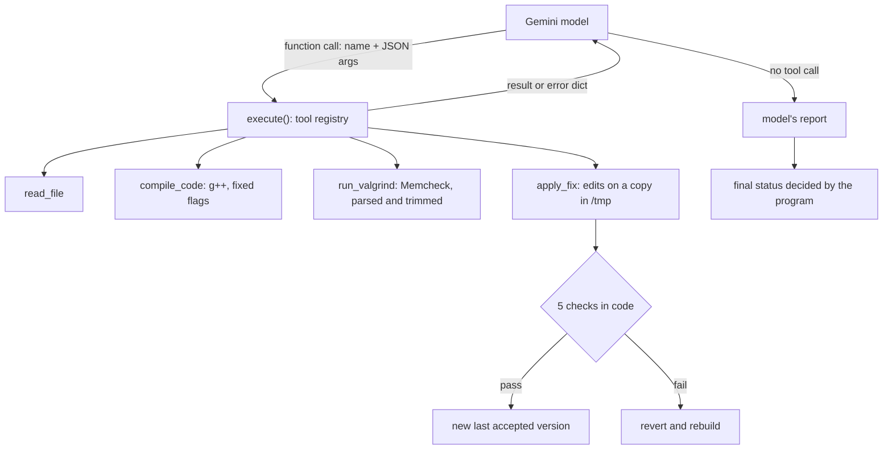

# C++ Memory Leak Analysis & Repair Agent

A Python agent that finds memory leaks in small C++ programs and proposes fixes. A Gemini model decides which tools to call; the program decides what those tools may do and whether a fix is accepted.

- **Analysis agent** (`leak_agent.py`): reads a C++ file, compiles it, runs it under Valgrind Memcheck, and writes a report that separates leaks Valgrind *observed* from leaks only *suspected* from the source. When the code depends on its command-line arguments, the model picks arguments that reach the suspicious path.
- **Repair agent** (`repair_agent.py`): does the same analysis, then proposes a fix as exact search-and-replace edits. The fix is applied to a copy, recompiled and re-run under Valgrind. It is kept only if it passes five checks; otherwise it is reverted.

## How it works



| Decided by the model | Decided by the program |
|---|---|
| Which tool to call next, and with which arguments | What each tool may do: paths, compiler flags, timeouts, limits |
| Which program inputs to try | Whether a fix is accepted, and reverting it |
| The text of each fix, and the report | When to stop, and the final status |

### The tools

The model can only call these four functions. There is no shell access.

| Tool | What it does | Limits |
|---|---|---|
| `read_file(path)` | Returns a source file with line numbers | Path must resolve inside the workspace (blocks `../`, absolute paths and symlinks); C/C++ files only; max 100 KB |
| `compile_code(source_file)` | Runs `g++ -std=c++17 -g -O0 -Wall -Wextra` | Flags fixed in code; argument list, never a shell string; binaries go to `/tmp/leak-agent/build`; 30 s timeout |
| `run_valgrind(executable, args)` | Runs a compiled program under `valgrind --leak-check=full` and returns a parsed summary | Only binaries built by `compile_code`; at most 5 arguments of 100 characters; 60 s timeout; output trimmed |
| `apply_fix(source_file, edits, explanation)` | Applies search-and-replace edits and returns the program's verdict | Repair agent only; each `old_text` must match exactly once; at most 20 changed lines; standard headers only; shown to you for approval before it runs (unless `--no-review`); at most 3 attempts |

### The five checks (`repair.py`)

Before anything is written or run, a fix must stay within two limits, or it is refused without using an attempt:

- **Size:** at most 20 lines changed against the original, counted as a diff counts them. The largest accepted fix in the evaluation changed 14.
- **Includes:** only headers from the standard folders (`/usr/include`, `/usr/lib/gcc`). The check asks `g++ -M` which files the preprocessor would open, so a macro, a comment, a line splice or a digraph can't hide an include. The preprocessor's messages never go back to the model, because a compile error can quote lines of the included file.

A fix is accepted only if, in this order:

1. it compiles;
2. the output and exit code equal the **original** program's on every predefined input (`testcases/inputs.json`);
3. it adds no new memory errors compared with the **last accepted** version;
4. it loses no more bytes than the last accepted version;
5. lost bytes or memory errors went down.

A rejected fix is reverted and the program is rebuilt. The rejection reason goes back to the model, which can try again. The files in `testcases/` are never modified; repairs happen in `/tmp/leak-agent/work/`.

### Review before a fix runs

By default, every fix that passes the format and limit checks is shown to you, with the diff and the model's reason, before it is written, compiled or run. Type `y` to run it. Enter declines; any other text declines and is sent to the model as the reason. A declined fix uses no attempt. With review on, the agent refuses to start without a terminal. `--no-review` runs fixes without asking; `evaluate.py` uses it because its runs are unattended.

## Running it

Requires Linux, Python 3.10+, `g++` and Valgrind (`sudo apt install valgrind`), plus a Gemini API key.

```bash
python3 -m venv .venv && source .venv/bin/activate
pip install -r requirements.txt
export GEMINI_API_KEY=...           # read from the environment, never stored in the code

python leak_agent.py 10_config_mode.cpp      # analysis only
python repair_agent.py 07_partners.cpp       # analysis + repair; asks before each fix runs
python repair_agent.py --no-review 07_partners.cpp   # runs fixes without asking
```

A real repair run on `07_partners.cpp` (18 Oct 2026). The first fix doesn't compile and is rejected; the second is accepted:

```text
[step 1] model -> read_file({'path': '07_partners.cpp'})
[step 1] program -> file content
[step 2] model -> compile_code({'source_file': '07_partners.cpp'})
[step 2] program -> {'success': True}
[step 3] model -> run_valgrind({'executable': '07_partners'})
[step 3] program -> {'lost': {'definitely_lost': 64, 'indirectly_lost': 64}}
[step 4] model -> apply_fix({'explanation': 'Changing the partner pointer to std::weak_ptr breaks the circular reference that causes the memory leak.', 'source_file': '07_partners.cpp', 'edits': '1 edit(s)'})
[step 4] program -> {'accepted': False, 'reason': 'does not compile or run', 'attempts_left': 2}
[step 5] model -> apply_fix({'source_file': '07_partners.cpp', 'explanation': 'Added get_partner() to access the weak_ptr and updated the usage in main to use .lock() via get_partner().', 'edits': '2 edit(s)'})
[step 5] program -> {'accepted': True, 'status': 'fixed', 'lost_bytes': '128 -> 0', 'memory_errors': '0 -> 0', 'attempts_left': 1}

===== DECIDED BY THE PROGRAM =====
status:   fixed: no leak or memory error observed on the predefined inputs
attempts: 2 of 3
```

## Tests

68 deterministic checks with no API calls. They use temporary folders and confirm that `testcases/` is unchanged.

```bash
python tests/test_tools.py     # 30 checks: path escapes, fixed flags, stale binaries, Valgrind parsing, argument limits
python tests/test_repair.py    # 38 checks: edit format, size and include limits, review before running, each of the five checks, revert, partial then complete fixes
```

## Evaluation

`evaluate.py` runs both agents several times on every test program and scores each run against `expected.json`, the ground truth: for each program, the planted problem, the line Valgrind will point to (the allocation) and the lines where the bug really is. The file sits outside `testcases/`, and `read_file` opens only C/C++ files, so the agents never see it. The repair agent runs with `--no-review` here.

- **Recording without changing the agents:** while an agent runs, its `execute()` and `call_model()` are temporarily replaced by wrappers that call the real function, record the tool call, tokens or final report, and return the same result.
- **Analysis runs:** was the problem observed by Valgrind, and does the report's "Root cause" section name a real root-cause line or only the allocation line?
- **Repair runs:** the program's final status and number of fix attempts, plus flags on the accepted diff: `try`/`catch` added, a function signature changed, a manual `delete` added.
- **Every written report:** overclaims such as "leak-free", byte counts that differ from what the tools returned, and Valgrind lines that never existed. These checks are pattern matches, so every hit is saved for a person to review.

```bash
python evaluate.py --only 10_config_mode.cpp --runs 1    # 2 agent runs, about 10 model calls
python evaluate.py                                       # 10 programs x 3 runs x 2 agents: about 300 model calls
python evaluate.py --rescore results/<time>.json         # recompute the scores from a saved run; no API calls
```

Each run writes `results/<time>.json` with every report, tool call and diff. The script prints its estimated number of model calls before starting, and stops early on a daily-quota error.

## Test programs

| File | Planted problem |
|---|---|
| `01_point.cpp` | `new` never deleted |
| `02_name_buffer.cpp` | `malloc` never freed |
| `03_sum_positive.cpp` | an early return skips `delete[]` |
| `04_labels.cpp` | objects returned from a function are never deleted, in a loop |
| `05_buffer_process.cpp` | an exception skips the deletes |
| `06_scores.cpp` | `new[]` released with `delete` (memory error, no leak) |
| `07_partners.cpp` | `shared_ptr` cycle |
| `08_linked_sum.cpp` | none: a clean control case |
| `09_list_and_counts.cpp` | only the head of a linked list is freed |
| `10_config_mode.cpp` | leaks only when run with the argument `debug` |
| `11_2d_array.cpp` | the rows of a 2D array are never freed, only the array of row pointers |

`11` is not in `expected.json` yet, so `evaluate.py` does not run it; the results below cover `01`–`10`.

`testcases/inputs.json` lists the program arguments the repair checks use; `expected.json` holds the ground truth for the evaluation.

## Results

One evaluation run on 18 Oct 2026 with `gemini-3.1-flash-lite`: each agent ran 3 times on each of the 10 programs (60 agent runs, 287 model calls, about 18 minutes). The results file is not included; results vary between runs.

- **Analysis:** the planted problem was observed in 27 of 27 runs on the 9 buggy programs. Nothing was observed on the clean program in 3 of 3 runs.
- **Repair:** a fix passing all five checks was accepted in 27 of 27 runs on the 9 buggy programs. No fix was attempted on the clean program in 3 of 3 runs.
- **Fix attempts:** of 31 attempts, 27 were accepted, 3 didn't compile (the first attempt on `07`, every time) and 1 added a new memory error.
- **Written reports:** 8 of 60 overclaimed, misquoted a number, or quoted Valgrind output that never existed. This is why the final status comes from the program, not from the model's report.

## Limitations

- Tested only on small single-file programs; there is no build-system support.
- Valgrind checks only the code paths that actually ran. "0 bytes lost" means no leak was observed on those inputs, not that none exists.
- The behaviour check is only as strong as the predefined inputs. Replacing all of `01_point.cpp` (12 lines) with a program that just prints the expected output changes only 12 lines, so it passes the size limit and every check and is accepted as fixed. The size limit stops whole-file rewrites only in longer programs; inputs the model never sees, or a human review of the diff, would catch it. The model never did this in the evaluation.
- A fix can pass every check and still be poor style: on `04` the model changed a function's signature in 3 of 3 runs.
- On a harder LRU-cache program whose leak needs four coordinated pointer fixes, the leak was observed but never fixed. Every wrong fix was rejected.
- The test programs, and every proposed fix, run as the current user, with no container, network block or memory limit. With `--no-review`, a fix runs before anyone sees it, and a rejected fix has still run. Review relies on the person reading the diff. The include check stops compile errors from quoting files, but a fix can still open files when it runs.
- The Gemini free tier allows a limited number of requests per day.
